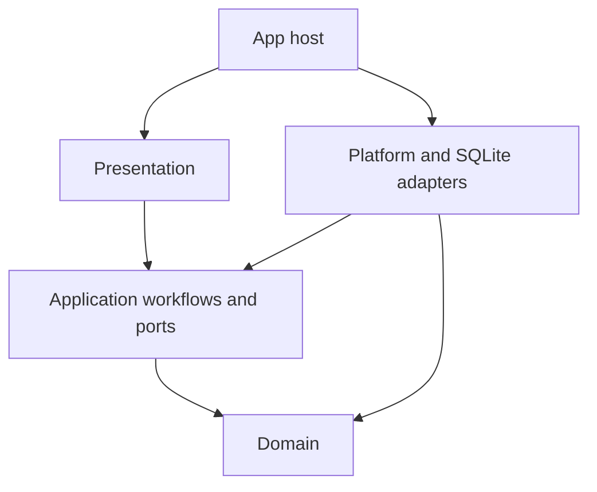

# Architecture

Dict Local AI uses ports and adapters. SwiftPM enforces the dependencies of the domain, application, and SQLite targets.

| Location               | Responsibility                                                                                                                          |
| ---------------------- | --------------------------------------------------------------------------------------------------------------------------------------- |
| `DictCore`             | Transcripts, speaker edits, recognition algorithms and independent rules.                                                               |
| `DictApplication`      | Dictation, file transcription, meeting, history and model setup workflows. Their outbound ports describe the effects they need.         |
| `DictStorage`          | SQLite repository, schema, queries, transactions and error mapping.                                                                     |
| `DictLocalAI/Features` | SwiftUI screens and observable controllers. Translate UI events into calls, maintain display state and render results.                  |
| `DictLocalAI/Platform` | Core ML and audio adapters, hotkeys, Accessibility, clipboard, system permissions, preferences, model files, exports and local logging. |
| `DictLocalAI/App`      | AppKit lifecycle and navigation, plus the composition root that builds and connects the concrete adapters.                              |

The host is the entry point and composition root. Application workflows own use-case decisions. Their dependencies point inward to domain types or to ports defined in the application target. Use cases do not call other use cases through methods, closures or adapters. Reuse domain operations when the behavior has the same meaning. Keep separate rules for dictation, files and meetings when their outcomes differ.

`DictationWorkflow` uses a recording writer directly. The controller captures the target at stop and passes insertion effects to the completion policy. Delivery never retries an unconfirmed Command-V. File transcription has independent retention eligibility and can keep a partial transcript after failure or cancellation. Meeting autosave uses a serial journal adapter. It receives a retention period from the workflow. History edits share the domain transcript operation with meeting edits. The history workflow writes the draft before the controller marks it clean. The host schedules periodic history refresh.

Model setup chooses when to allow downloads, verify the cache and activate a model. The macOS adapter handles Hugging Face, local files, and loading Core ML. Publication happens after warmup and before the active model is swapped. The same separation keeps permission calls, SwiftUI, and AppKit out of the application target.

The Mac host, presentation and platform adapters share the executable target. Source contracts guard known dependency and construction paths inside that target. SwiftPM does not enforce those internal folders. Platform-specific callbacks, errors, progress messages and the inference pipeline use the Mac target's types. SQLite schema, transcript formats, preferences keys and signing identity remain stable.
